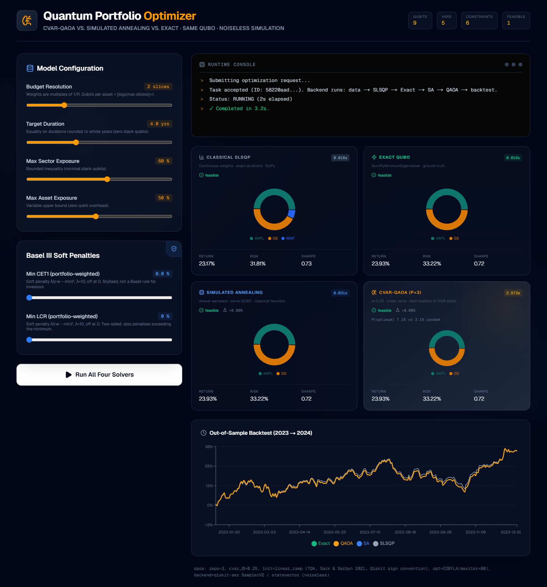
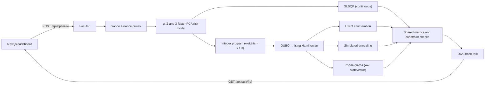

<div align="center">

# Quantum Portfolio Optimizer

**Constrained portfolio optimisation with QAOA: implemented end to end, benchmarked against exact and classical
baselines, and independently verified.**


[](https://github.com/Ziadt160/QuantumPortfolio/actions/workflows/ci.yml)
[](LICENSE)



</div>

## Overview

Quantum Portfolio Optimizer solves one mean–variance portfolio problem, with budget, duration, sector, per-asset
and bank-capital constraints, with four solvers and compares them side by side:

| Solver | Type | Implementation |
|---|---|---|
| **SLSQP** | Classical, continuous weights | SciPy |
| **Exact QUBO** | Classical, exhaustive over the discretised problem | Qiskit `NumPyMinimumEigensolver` |
| **Simulated annealing** | Classical heuristic on the same QUBO | dwave-samplers |
| **CVaR-QAOA** | Variational quantum algorithm on the same QUBO | Qiskit + qiskit-aer (noiseless statevector simulation) |

The backend builds the problem from real market data (Yahoo Finance, 2020–2022), encodes it as a QUBO and an Ising
Hamiltonian, runs all four solvers, and back-tests every portfolio on 2023. A Next.js dashboard lets you change the
constraints and compare the results.

The project is **verification-first**. Every number it reports has been recomputed by independent code, and every
claim is stated with its limits. See [Results](#results) and [Limitations](#limitations).

## Highlights

- **Complete quantum-optimisation pipeline:** market data → PCA factor risk model → integer program → QUBO →
  Ising Hamiltonian → CVaR-QAOA circuit → decoded portfolio.
- **Honest benchmarking:** QAOA is reported with its probability of sampling the optimum and compared with a
  random-sampling null model, not only by whether it "found" the answer.
- **Literature-faithful QAOA:** CVaR aggregation (Barkoutsos et al., 2020) and a linear-ramp/TQA start
  (Sack & Serbyn, 2021), adapted to Qiskit's mixer sign convention and Hamiltonian scale.
- **Verified numerics:** 69 independent checks (QUBO energies for every bitstring, Ising endianness, statevector
  agreement, KKT optimality, CVaR, backtest arithmetic). 50 automated tests including property-based tests;
  a mutation check confirms the regression tests catch the defects they guard.
- **Reproducible:** exact dependency pins plus a full lock file, tested clean installs on Python 3.11 and 3.13,
  a frozen data snapshot with SHA-256 hashes, and seeded stochastic solvers.
- **Production hygiene:** validated API inputs, explicit failure reporting, restricted CORS, bounded resources,
  no known vulnerable production dependencies (`pip-audit`, `npm audit`, October 2026).

## Results

Default dashboard settings, frozen 2020–2022 data snapshot ([AUDIT_NUMERICS.md](AUDIT_NUMERICS.md)):

| Solver | Portfolio | Return | Volatility | Time |
|---|---|---|---|---|
| SLSQP (continuous) | AAPL 50 %, GS 43.3 %, WMT 6.7 % | 23.17 % | 31.81 % | 0.02 s |
| Exact QUBO | AAPL 50 %, GS 50 % | 23.93 % | 33.22 % | 0.02 s |
| Simulated annealing | AAPL 50 %, GS 50 % | 23.93 % | 33.22 % | 0.03 s |
| CVaR-QAOA (p = 3, 9 qubits) | AAPL 50 %, GS 50 % | 23.93 % | 33.22 % | 2.6 s |

Repeated trials ([AUDIT_NUMERICS.md §4](AUDIT_NUMERICS.md#4-stochastic-behaviour-of-qaoa-repeated-trials)):

| Problem size | QAOA found optimum | Random sampling would find it | QAOA probability on the optimum vs random guessing |
|---|---|---|---|
| 9 qubits (20 seeds) | 20 / 20 | ≈ 100 % | 2.5–2.6× |
| 18 qubits (10 seeds) | 10 / 10 | 63 % | 3.3× |

**How to read these results**

- At the default settings the discrete problem has exactly **one** feasible portfolio (the dashboard shows this
  as "Feasible 1"), so the discrete solvers must agree. Larger budget resolutions give more choice.
- At 9 qubits, picking the best of 1024 random bitstrings also finds the optimum. QAOA's advantage over guessing is
  measured by how much probability its quantum state puts on the optimum: 2.5–3.3× more than uniform sampling.
- **No quantum speed-up is claimed.** At every size a laptop can simulate, exhaustive classical search is faster
  (0.3 ms for all 512 states at 9 qubits). The value of this project is a correct, transparent and measurable QAOA
  pipeline, not a speed record.

## How it works



### Problem formulation

Weights $w$ minimise a risk–return trade-off with risk aversion $q \in [0,1]$:

$$\min_{w}\; q\,w^\top \Sigma\, w \;-\; (1-q)\,\mu^\top w$$

subject to $\sum_i w_i = 1$, $0 \le w_i \le a_{\max}$, portfolio duration $d^\top w = T$, sector caps, and optional
portfolio-weighted CET1 / LCR floors. $\mu$ and $\Sigma$ are annualised from daily returns. $\Sigma$ comes from a
3-factor PCA model $B F B^\top + \mathrm{diag}(D)$, shared by all four solvers.

The discrete solvers use integer weight slices $w_i = x_i / R$. Equality and inequality constraints become quadratic
penalties (inequalities through slack variables), giving a QUBO over bits $b$:

$$E(b) = f\big(x(b)\big) + P \sum_k \big(a_k^\top x(b) + s_k(b) - r_k\big)^2$$

Mapping $b_i = (1 - Z_i)/2$ turns this into a diagonal Ising Hamiltonian $H_C$. QAOA prepares

$$|\psi(\beta,\gamma)\rangle = \prod_{l=1}^{p} e^{-i\beta_l \sum_j X_j}\, e^{-i\gamma_l H_C}\, |+\rangle^{\otimes n}$$

and optimises the CVaR (the mean of the best α = 25 % of sampled energies) with COBYLA. The returned portfolio is
the best feasible bitstring among 1024 shots of the final circuit.

### Key design decisions

| Decision | Reason |
|---|---|
| CVaR instead of the mean energy | Focuses the optimiser on the low-energy tail that matters for optimisation (Barkoutsos et al., 2020). |
| Linear-ramp (TQA) initial point, negative β | Qiskit's mixer is +ΣX, the paper's is −ΣX. Without the sign flip the ramp anneals toward the *worst* solutions. |
| Cost Hamiltonian scaled to max \|coefficient\| = 1 | Keeps phases from wrapping and makes the optimiser's step size meaningful (at the defaults, P(optimum) rose from ≈ 1.5× to 2.5× uniform). |
| Statevector instead of matrix-product-state simulation | Dense all-to-all couplings are MPS's worst case: 0.10 s vs 18 s per circuit at 18 qubits. |
| One shared metrics function for all solvers | Ensures the four cards are directly comparable; violations are reported, never hidden. |

## Getting started

### Prerequisites

- Python 3.11 or 3.13
- Node.js 22 and npm
- Tested on Windows 11; Linux and macOS are expected to work but are untested
- Internet access (Yahoo Finance) for the live app; tests run offline

### Backend

```bash
git clone https://github.com/Ziadt160/QuantumPortfolio.git
cd QuantumPortfolio/backend

python -m venv .venv
.venv\Scripts\activate            # Windows.  macOS/Linux: source .venv/bin/activate
pip install -r requirements-dev.txt

python -m pytest                  # 50 tests, ~30 s
uvicorn main:app --port 8000      # http://127.0.0.1:8000  (API docs at /docs)
```

### Frontend

```bash
cd frontend                       # from the repository root
npm install
npm run dev                       # http://localhost:3000
```

Open http://localhost:3000, adjust the constraints and click **Run All Four Solvers**. A run takes about 3–10 s at
the default settings.

### Configuration

| Variable | Default | Purpose |
|---|---|---|
| `QP_ALLOWED_ORIGINS` (backend) | `http://localhost:3000,http://127.0.0.1:3000` | Origins allowed by CORS |
| `NEXT_PUBLIC_API_BASE_URL` (frontend, build time) | `http://localhost:8000` | Backend URL used by the dashboard |

## API

| Method | Endpoint | Description |
|---|---|---|
| `GET` | `/api/universe` | Default ticker universe |
| `POST` | `/api/optimize` | Start an optimisation; returns `{"task_id": ...}` |
| `GET` | `/api/task/{task_id}` | `PENDING` → `RUNNING` → `COMPLETED` (with result) or `FAILED` (with error). Unknown id → 404 |

```bash
curl -X POST http://127.0.0.1:8000/api/optimize \
  -H "Content-Type: application/json" \
  -d '{"tickers": ["AAPL", "JPM", "JNJ", "WMT", "GS"], "budget_resolution": 2, "target_duration": 4.0}'
```

Main request fields (all validated; invalid requests return 422):

| Field | Default | Range | Meaning |
|---|---|---|---|
| `tickers` | — | 2–12 unique symbols | Asset universe |
| `budget_resolution` | 2 | 1–8 | Weights are multiples of 1/R |
| `q_factor` | 0.5 | 0–1 | Risk aversion |
| `target_duration` | 4.0 | (0, 30] | Portfolio duration target (years) |
| `max_sector_exposure`, `max_asset_exposure` | 0.60, 0.50 | (0, 1] | Caps |
| `min_cet1`, `min_lcr` | 0, 0 | ≥ 0 | Bank-ratio floors (soft penalty, off at 0) |
| `qaoa_reps`, `qaoa_cvar_alpha`, `qaoa_maxiter`, `qaoa_shots` | 3, 0.25, 80, 1024 | bounded | QAOA settings |
| `seed` | 42 | int | Seeds QAOA sampling and simulated annealing |

Each solver result includes weights, return, volatility, Sharpe ratio, objective, feasibility and violations.
QAOA also reports `p_optimal` vs `uniform_p_optimal`, and the response includes `num_feasible_portfolios` and
the effective discretised constraints. The interactive schema is at `/docs`.

## Testing and verification

| Layer | What it covers | Command |
|---|---|---|
| Unit and property-based tests | Moments, factor model, QP objective at every grid point, QUBO/Ising energies for every bitstring, QAOA state vs an independent NumPy simulation, unitarity, CVaR, API validation | `cd backend && python -m pytest` |
| Independent numerical audit | 69 checks against reference implementations on a frozen data snapshot | `python audit/verify_numerics.py` |
| Stochastic study | Repeated QAOA trials with confidence intervals vs SA and a null model | `python audit/qaoa_study.py` (see below) |
| Mutation check | Re-introduces each fixed defect and confirms its test fails (7/7) | `python audit/mutate.py <dir> <python>` |
| Frontend | Type-check, lint, production build, browser run | `npx tsc --noEmit`, `npm run lint`, `npm run build` |
| Continuous integration | Every push and pull request: backend tests on Python 3.11 and 3.13 (Linux), frontend type-check/lint/build, dependency audit | [`.github/workflows/ci.yml`](.github/workflows/ci.yml) |

<details>
<summary><b>Reproducing the audit</b></summary>

From the repository root, with the backend environment active:

```bash
python audit/run_pipeline_snapshot.py --code current --out audit/results/current_pipeline_default.json
python audit/verify_numerics.py
python audit/qaoa_study.py --configs C1,C2 --seeds 20 --out audit/results/qaoa_study_9q.jsonl
python audit/qaoa_study.py --configs C3 --seeds 10 --out audit/results/qaoa_study_18q.jsonl
python audit/analyze_qaoa_study.py audit/results/qaoa_study_9q.jsonl audit/results/qaoa_study_18q.jsonl
```

`audit/data/` holds the frozen price snapshot (SHA-256 hashes in AUDIT_NUMERICS.md). `audit/original_backend/` is
the code before the audit, preserved byte-exact; it needs `qiskit-algorithms` 0.3.x to run.

</details>

The full audit is documented in eight reports: start with **[AUDIT_SUMMARY.md](AUDIT_SUMMARY.md)**.

| Report | Content |
|---|---|
| [AUDIT_SCIENCE.md](AUDIT_SCIENCE.md) | Mathematical formulation, claims and verdicts, quantum-specific checks |
| [AUDIT_NUMERICS.md](AUDIT_NUMERICS.md) | Independent recomputation of every reported number; repeated-trial study |
| [AUDIT_CORRECTNESS.md](AUDIT_CORRECTNESS.md) | Defects found, with location, impact, reproduction and fix |
| [AUDIT_TESTING.md](AUDIT_TESTING.md) | Test suite, mutation check, clean-install runs |
| [AUDIT_REPOSITORY.md](AUDIT_REPOSITORY.md), [AUDIT_CODE_QUALITY.md](AUDIT_CODE_QUALITY.md), [AUDIT_PRODUCTION.md](AUDIT_PRODUCTION.md) | Architecture, code quality, security and operational readiness |

## Project structure

```
QuantumPortfolio/
├── backend/
│   ├── main.py               FastAPI app: validation, task lifecycle, orchestration
│   ├── quant_engine.py       Market data, risk model, SLSQP, shared metrics, back-test
│   ├── quantum_engine.py     QUBO formulation, exact / simulated annealing / CVaR-QAOA solvers
│   ├── tests/                50 tests (pytest + Hypothesis), offline synthetic data
│   └── requirements*.txt     Exact pins, dev tools, full lock file
├── frontend/
│   └── src/app/Dashboard.tsx Interactive dashboard (Next.js 16, Recharts, Tailwind)
├── audit/                    Verification scripts, frozen data snapshot, results, original code
├── docs/images/              Screenshots
└── AUDIT_*.md                Audit reports
```

## Limitations

- **Simulation only.** QAOA runs on a noiseless classical simulator; no noise model or quantum hardware is used.
  The code accepts up to 24 qubits.
- **No quantum advantage** is claimed or expected at these sizes (see [Results](#results)).
- **Sparse discrete problem.** Durations are rounded to whole years and enforced as an equality, so few
  portfolios are feasible (exactly one at the defaults).
- **Stylised constraints.** CET1/LCR floors are portfolio-weighted bank ratios, a modelling device rather than a
  Basel III requirement on investors. Duration and bank-ratio values are illustrative constants.
- **Local demo.** In-memory task store, no authentication or rate limiting. Suitable for a single local user,
  not as a public service ([AUDIT_PRODUCTION.md](AUDIT_PRODUCTION.md)).

## Roadmap

- [ ] Duration *band* instead of an equality, so the risk–return objective drives the discrete solution
- [ ] Remove redundant constraint slack qubits (9 → 6 qubits at the defaults)
- [ ] Noisy simulation and a run on IBM Quantum hardware via Qiskit Runtime
- [ ] Equal-budget benchmark of QAOA vs simulated annealing over many instances and sizes
- [x] Continuous integration (tests on Python 3.11/3.13, frontend checks, `pip-audit`, `npm audit`)
- [ ] Typed API response models and a Python linter (ruff) in CI

## References

1. E. Farhi, J. Goldstone, S. Gutmann. *A Quantum Approximate Optimization Algorithm.* arXiv:1411.4028 (2014).
2. P. Kl. Barkoutsos, G. Nannicini, A. Robert, I. Tavernelli, S. Woerner. *Improving Variational Quantum
   Optimization using CVaR.* Quantum 4, 256 (2020).
3. S. H. Sack, M. Serbyn. *Quantum annealing initialization of the quantum approximate optimization algorithm.*
   Quantum 5, 491 (2021).
4. A. Lucas. *Ising formulations of many NP problems.* Frontiers in Physics 2, 5 (2014).
5. F. Glover, G. Kochenberger, Y. Du. *A Tutorial on Formulating and Using QUBO Models.* arXiv:1811.11538 (2019).

## License

Released under the [MIT License](LICENSE).
